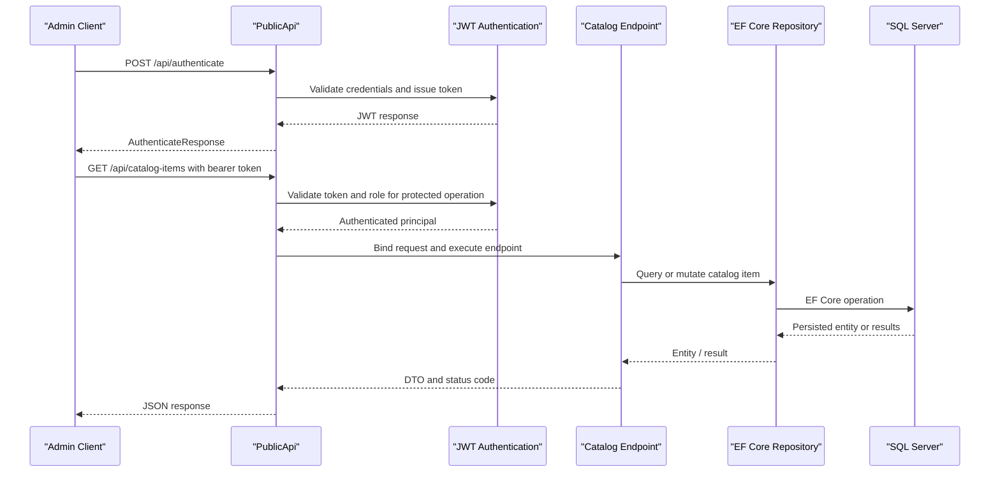

# API & Service Communication Contracts

The solution exposes a storefront through MVC/Razor routes and a JSON PublicApi for catalog and authentication operations. The admin client communicates with PublicApi over synchronous HTTP; no asynchronous message transport was identified.

## Service Catalog

| Service | Port | Category | Purpose |
|---|---|---|---|
| Web | 5000 / 5001 (local profile) | API/UI Layer | Storefront, account, basket, checkout, and orders |
| PublicApi | 5098 / 5099 (local profile) | API Layer | Catalog and authentication endpoints |
| BlazorAdmin | 5000 / 5001 (local profile) | Client UI | Administrative catalog client |
| SQL Server | 1433 (Docker Compose) | Infrastructure | Catalog and identity persistence |

## API Endpoints Inventory

| Service | Method | Path | Request Type | Response Type |
|---|---|---|---|---|
| PublicApi | GET | `/api/catalog-items` | Pagination and filter query parameters | `PagedCatalogItemResponse` |
| PublicApi | GET | `/api/catalog-items/{catalogItemId}` | Path parameter | `CatalogItemDto` |
| PublicApi | POST | `/api/catalog-items` | `CreateCatalogItemRequest` | `CreateCatalogItemResponse` |
| PublicApi | PUT | `/api/catalog-items` | `UpdateCatalogItemRequest` | `UpdateCatalogItemResponse` |
| PublicApi | DELETE | `/api/catalog-items/{catalogItemId}` | Path parameter | Delete result |
| PublicApi | GET | `/api/catalog-brands` | None | `CatalogBrandResponse` |
| PublicApi | GET | `/api/catalog-types` | None | `CatalogTypeResponse` |
| PublicApi | POST | `/api/authenticate` | `AuthenticateRequest` | `AuthenticateResponse` with JWT |
| Web | GET | `/Order/MyOrders` | Authenticated identity | Orders view |
| Web | GET | `/Order/Detail/{orderId}` | Path parameter | Order detail view |
| Web | GET / POST | `/Manage/{action}` | Account and management models | MVC views / action results |
| Web | GET / POST | `/User/{action}` | Login/logout models | MVC views / action results |

## Management & Observability Endpoints

| Service | Endpoint | Custom Metrics (if any) |
|---|---|---|
| PublicApi | `/swagger` and `/swagger/v1/swagger.json` | None identified |
| Web / PublicApi | No dedicated health endpoint found | None identified |

## DTOs & Contracts

PublicApi contracts include `AuthenticateRequest` / `AuthenticateResponse`, `CreateCatalogItemRequest` / `CreateCatalogItemResponse`, `UpdateCatalogItemRequest` / `UpdateCatalogItemResponse`, `CatalogItemDto`, `PagedCatalogItemResponse`, `CatalogBrandResponse`, and `CatalogTypeResponse`. These are mutable DTO classes; no gateway-level aggregation model was found. Domain entities are persisted through the repository layer rather than exposed as a cross-service contract. JSON serialization uses `System.Text.Json`; Swagger/OpenAPI is generated with Swashbuckle.

## Communication Patterns

BlazorAdmin makes synchronous HTTP calls to PublicApi using `HttpClient`. Web controllers and Razor Pages call application services directly in-process. PublicApi endpoints use application services/repositories and EF Core; no queue, event broker, service discovery, retry, circuit breaker, or client-side load balancing configuration was found. API catalog mutations require the administrator role and JWT bearer authentication; the authentication endpoint issues tokens. The storefront uses ASP.NET Core Identity authorization and HTTPS redirection. TLS is configured for local HTTPS profiles, while Docker development URLs use HTTP; no inter-service TLS policy was found.

## Service Technology Matrix

| Service | Web | Data Access | Discovery | Gateway | Health | Cache | Metrics |
|---|---|---|---|---|---|---|---|
| Web | MVC / Razor Pages | EF Core repositories | None | None | None found | Memory cache for catalog views | None found |
| PublicApi | Minimal API / controllers | EF Core repositories | None | None | None found | Memory cache registered | None found |
| BlazorAdmin | Blazor WebAssembly | HTTP client to PublicApi | None | None | N/A | Client-side cached service decorators | None found |

## Service Communication Sequence

