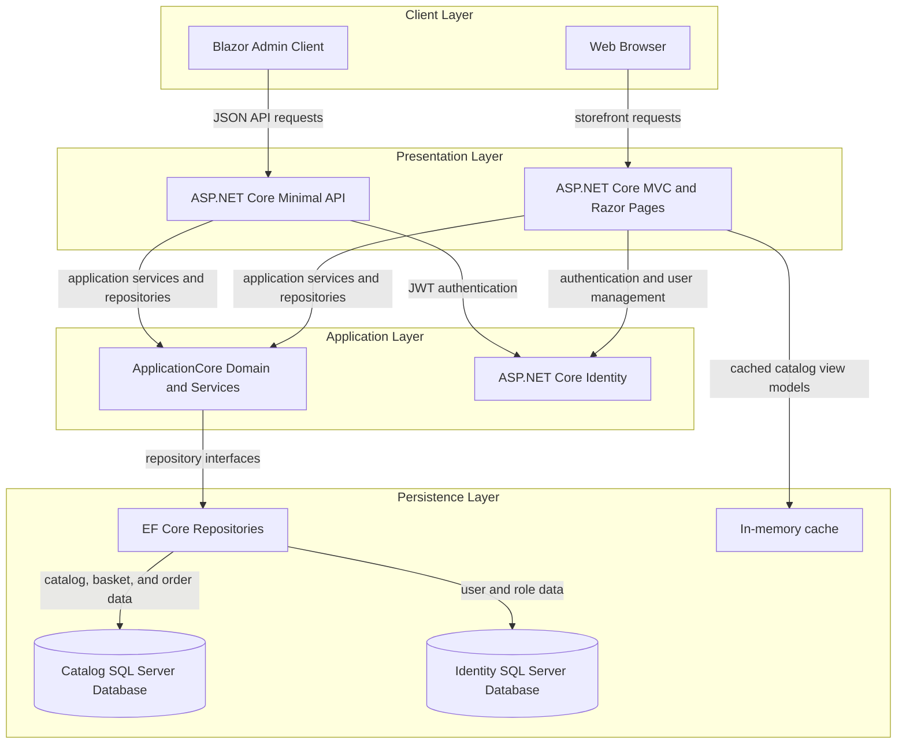
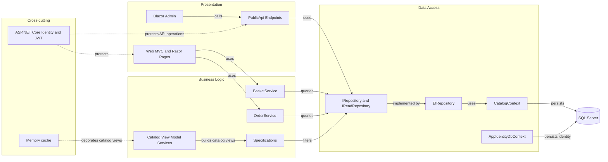

# Architecture Diagram

eShopOnWeb is a sample online storefront with a server-rendered web application and a separate catalog/authentication API. The solution separates domain and application logic from ASP.NET Core presentation and Entity Framework Core infrastructure.

## Application Architecture

### Technology Stack Summary

| Layer | Technology | Version | Purpose |
|---|---|---:|---|
| Web presentation | ASP.NET Core MVC and Razor Pages | .NET 8 | Storefront, account, basket, and order pages |
| API presentation | ASP.NET Core Minimal APIs and controllers | .NET 8 | Catalog and authentication API |
| Admin client | Blazor WebAssembly | .NET 8 | Administrative catalog client |
| Application | C# / .NET | net8.0 | Domain entities, services, specifications, and interfaces |
| Data access | Entity Framework Core | 8.0.2 | SQL Server and in-memory persistence |
| Identity | ASP.NET Core Identity | 8.0.2 | User, role, and authentication management |

### Data Storage & External Services

Catalog, basket, order, and identity data use SQL Server through separate catalog and identity contexts; an in-memory provider can be selected for testing or lightweight development. The web application also uses process-local memory caching for catalog view models. No message broker or external business API is configured in the inspected application.

### Key Architectural Decisions

- ApplicationCore owns business entities and service contracts; Infrastructure implements persistence with EF Core repositories.
- The MVC storefront and PublicApi are separate ASP.NET Core projects in the same solution and share ApplicationCore and Infrastructure.
- API authentication uses bearer JWTs, while the web application uses ASP.NET Core Identity/cookie authentication.

## Component Relationships

### Component Inventory

| Component | Layer | Type | Responsibility |
|---|---|---|---|
| Web | Presentation | MVC / Razor Pages | Storefront, basket, checkout, account, and order views |
| PublicApi | Presentation | Minimal API / controller endpoints | Catalog reads and administration, authentication |
| BlazorAdmin | Presentation | Blazor WebAssembly | Admin UI that calls PublicApi |
| BasketService | Business Logic | Application service | Basket creation, item/quantity changes, transfer |
| OrderService | Business Logic | Application service | Converts a non-empty basket into an order |
| CatalogViewModelService | Business Logic | View-model service | Catalog filtering, pagination, and presentation data |
| IRepository / IReadRepository | Data Access | Repository interfaces | Persistence abstraction consumed by application code |
| EfRepository | Data Access | EF Core repository | Implements repository operations |
| CatalogContext | Data Access | EF Core DbContext | Catalog, basket, and order persistence |
| AppIdentityDbContext | Data Access | Identity DbContext | ASP.NET Core user and role persistence |
| Identity and JWT | Cross-cutting | Authentication/authorization | Cookie and bearer-token identity |
| Memory cache | Cross-cutting | Process-local cache | Caches catalog view models |
