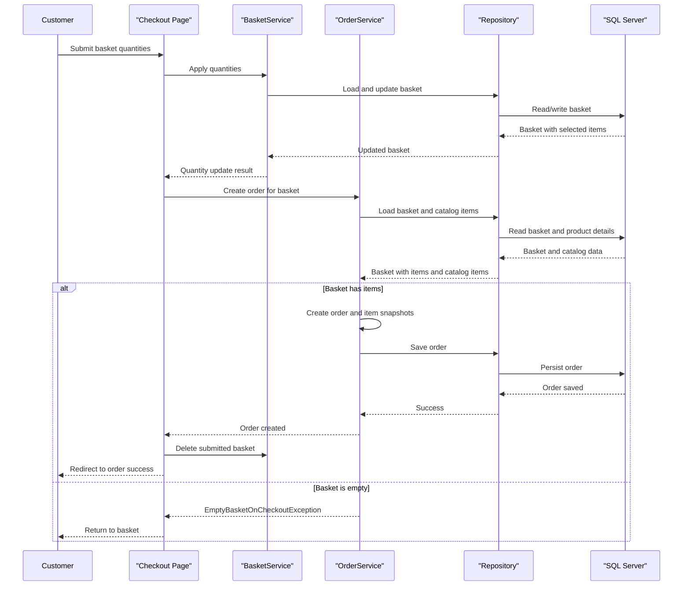

# Core Business Workflows

eShopOnWeb supports browsing a product catalog, managing a shopping basket, and placing orders through a sample storefront. Administrators maintain catalog data through a separate authenticated client and API.

## Domain Entities

| Entity | Service / Bounded Context | Description | Key Relationships |
|---|---|---|---|
| CatalogItem | Catalog | A product offered for sale | Classified by CatalogType and CatalogBrand |
| CatalogType | Catalog | Product category | Groups catalog items |
| CatalogBrand | Catalog | Product brand | Groups catalog items |
| Basket | Shopping | A buyer's current selection | Contains BasketItems; associated with a buyer identity |
| BasketItem | Shopping | Product and quantity selected in a basket | References a catalog item |
| Order | Ordering | A submitted purchase with shipping address | Contains OrderItems and belongs to a buyer |
| OrderItem | Ordering | A purchase-time snapshot of product and quantity | Belongs to one order |
| Buyer / PaymentMethod | Identity / Ordering | Customer identity and stored payment-method model | Buyer may have payment methods |

## Service-to-Domain Mapping

| Service | Domain Context | Owned Entities | External Dependencies |
|---|---|---|---|
| Web | Storefront, Shopping, Ordering | Basket and order workflows; catalog presentation | ApplicationCore, Infrastructure, ASP.NET Identity |
| PublicApi | Catalog and authentication | Catalog administration/read contracts and token issuance | ApplicationCore, Infrastructure, Identity |
| BlazorAdmin | Catalog administration UI | No persisted domain entities | PublicApi over HTTP |
| Infrastructure | Persistence | EF Core mappings for catalog, baskets, orders, and identity | SQL Server / EF Core |

## Primary Workflows

### Workflow 1: Customer checkout

1. An authenticated customer opens the basket and submits checkout.
2. The Web checkout page loads the buyer's basket and applies submitted item quantities.
3. `OrderService` loads the basket and its items, rejects a missing or empty basket, then loads catalog item details.
4. The service builds order-item snapshots and an `Order`, then persists it through the repository.
5. The basket is deleted after successful order creation and the customer is redirected to the success page.

### Workflow 2: Catalog administration

1. An administrator signs in and obtains a JWT from the authentication endpoint.
2. BlazorAdmin calls catalog endpoints with the bearer token.
3. API authorization restricts catalog create/update/delete operations to the administrator role.
4. The endpoint applies catalog changes through repository operations. The current create behavior stores a placeholder image rather than accepting an uploaded file.

## Cross-Service Data Flows

Web and PublicApi share the ApplicationCore and Infrastructure projects and access the same catalog persistence layer. The admin client receives API DTOs from PublicApi; no backend service aggregation or cross-service data composition pattern was identified. Checkout reads catalog details and basket state from the shared repository layer before writing the order.

## Business Workflow Sequence

## Business Rules & Decision Logic

- A checkout requires a non-empty basket; `EmptyBasketOnCheckout` rejects an empty selection.
- Basket items for the same catalog item are combined by increasing quantity; zero-quantity items are removed.
- Catalog item updates require non-empty name and description and a positive price.
- Orders retain ordered item names, image references, and prices as purchase-time snapshots.
- Checkout and order views require authentication; catalog mutation requires the administrator role.
- Persistence operations are performed through scoped EF Core repositories. No distributed transaction or asynchronous event workflow was identified.
