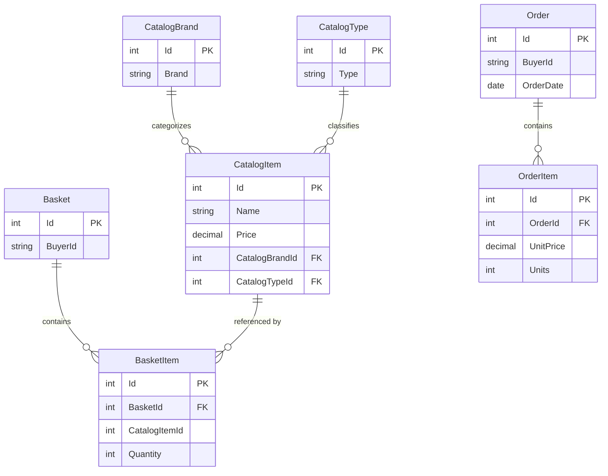

# Data Architecture & Persistence Layer

The application stores catalog, basket, and order aggregates with Entity Framework Core, and stores users and roles through ASP.NET Core Identity. SQL Server is the configured persistent provider, with an in-memory provider option.

## Database Configuration

| Service/Module | DB Type | Profile | Driver | Connection | Migration Tool |
|---|---|---|---|---|---|
| Web / PublicApi catalog | SQL Server | Default / Docker | EF Core SQL Server 8.0.2 | `CatalogConnection` setting (LocalDB in default appsettings; Docker SQL Server in container settings) | EF Core migrations |
| Web / PublicApi identity | SQL Server | Default / Docker | EF Core SQL Server 8.0.2 | `IdentityConnection` setting | EF Core migrations |
| Catalog and identity | EF Core InMemory | `UseOnlyInMemoryDatabase=true` | EF Core InMemory 8.0.2 | Named in-memory stores | None |

## Data Ownership per Service

| Service | Tables Owned | ORM Framework | Caching | Notes |
|---|---|---|---|---|
| Web / PublicApi shared persistence | Catalog items, brands, types, baskets, basket items, orders, order items | EF Core | Process-local memory cache for catalog views | Both application hosts use `CatalogContext` |
| Identity | ASP.NET Core Identity users, roles, claims, logins, tokens | EF Core Identity | None identified | Uses `AppIdentityDbContext` and a separate connection setting |

## Entity Model

Entities and mappings are defined under `src/ApplicationCore/Entities/` and configured through `CatalogContext` and EF Core configuration classes in `src/Infrastructure/Data/`. The `Order` aggregate snapshots ordered-item details and shipping address as value data. ASP.NET Identity owns its standard user/role model in `AppIdentityDbContext`.

## Key Repository Methods

| Service | Repository / Specification | Notable Methods | Purpose |
|---|---|---|---|
| Catalog | `IRepository<CatalogItem>` with `CatalogFilterPaginatedSpecification` | `ListAsync`, `CountAsync` | Apply catalog filters and pagination |
| Basket | `IRepository<Basket>` with `BasketWithItemsSpecification` | `FirstOrDefaultAsync`, `UpdateAsync`, `DeleteAsync` | Load baskets with items by buyer or basket ID |
| Orders | `IRepository<Order>` with customer/order specifications | `ListAsync`, `FirstOrDefaultAsync` | Retrieve customer orders and order details |
| Persistence | `EfRepository<T>` | Inherited Ardalis Specification repository operations | Shared EF Core implementation for aggregate roots |

## Caching Strategy

`IMemoryCache` is registered in the web and API hosts. Catalog view-model services use process-local caching for catalog listings and lookup data. No distributed cache, explicit cache TTL inventory, or second-level EF cache was found.

## Data Ownership Boundaries

The catalog, basket, and order aggregates share the catalog database and `CatalogContext`; the identity model is isolated behind `AppIdentityDbContext` and its own connection setting. Web and PublicApi are separate hosts over shared application and persistence code, not independently owned microservice databases. Cross-domain operations use repository interfaces and in-process application services; there is no cross-service REST data join or CQRS read store identified.

### Data Classification & Sensitivity

| Entity | Sensitive Fields | Classification (PII/PHI/PCI/None) | Controls in Place |
|---|---|---|---|
| Identity user | User name, email, password hash | PII / credentials | ASP.NET Identity password hashing; no field-level encryption identified |
| Basket | Buyer identifier | PII-linked identifier | No field-level masking identified |
| Order | Buyer identifier and shipping address | PII | No field-level encryption or masking identified |
| Catalog entities | Product descriptions, names, prices | None | Not applicable |

