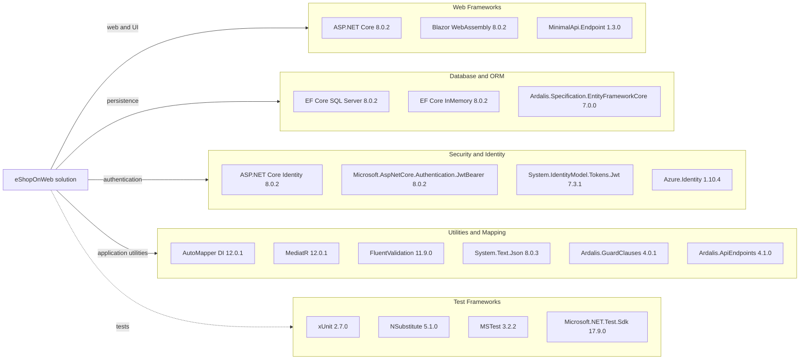

# Dependency Map

The .NET solution resolves 301 unique NuGet package/version pairs across its project dependency graphs, including 78 top-level package entries. Package versions are centrally managed in `Directory.Packages.props`.

## Dependencies

### Dependency Summary

| Category | Count shown | Key Libraries | Notes |
|---|---:|---|---|
| Web Frameworks | 3 | ASP.NET Core, Blazor WebAssembly, MinimalApi.Endpoint | Framework references are centrally versioned |
| Database / ORM | 3 | EF Core SQL Server, EF Core InMemory, Ardalis Specification | Supports SQL Server and in-memory provider |
| Security / Identity | 4 | ASP.NET Core Identity, JWT bearer, Azure.Identity | Authentication is split between cookies and JWT |
| Utilities | 6 | AutoMapper, MediatR, FluentValidation, System.Text.Json, Guard Clauses, API Endpoints | Shared application and endpoint utilities |

### Version & Compatibility Risks

Projects target `net8.0`, with framework and EF Core packages pinned to 8.0.2 and `System.Text.Json` to 8.0.3. A legacy `Microsoft.AspNetCore.Mvc` 2.2.0 package is also declared centrally and merits dependency-usage review. The dependency scan found advisory matches; see the security assessment for severity-filtered findings.

### Notable Observations

- Central package management in `Directory.Packages.props` keeps versions aligned across modules.
- The solution includes both SQL Server and in-memory EF Core providers.
- The resolved graph contains 301 unique package/version pairs; the package CLI also reported that `docker-compose.dcproj` uses legacy `packages.config`, so its packages are not represented in the JSON dependency graph.

## Test Dependencies

| Framework | Version | Notes |
|---|---:|---|
| xUnit | 2.7.0 | Unit and application tests |
| xUnit runner | 2.5.6 | Visual Studio test adapter |
| MSTest | 3.2.2 | Present in central package versions |
| NSubstitute | 5.1.0 | Test doubles |
| Microsoft.NET.Test.Sdk | 17.9.0 | Test execution infrastructure |
| coverlet.collector | 6.0.2 | Coverage collection |

Total test-scope dependencies: 6 listed central packages. The repository has unit, functional, integration, and public API integration test projects.
